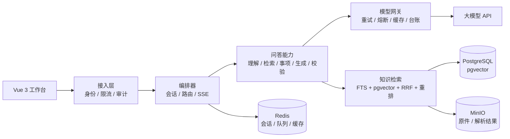

# 校园智能问答与办事指南

面向单所高校的校务问答与办事指南系统。用户用自然语言提问，系统从校内公开资料中检索依据、生成回答，并附上可核对的原文；证据不足时明确拒答，不猜测、不拼凑。

当前已完成：基础设施、知识入库、模型网关、检索问答、会话编排、接入控制、知识运营、评测反馈。

## 功能概览

| 模块 | 能力 |
| --- | --- |
| 校务问答 | 意图理解、检索融合、重排、有依据作答、逐条引用 |
| 可信拒答 | 超出范围、无证据、低置信、未通过核对四类口径 |
| 多问拆分 | 一轮识别多个子问题，并行作答后统一装配 |
| 流式回答 | SSE 推送阶段、增量文本、提示、错误与完成事件 |
| 会话记录 | Redis 热上下文 + PostgreSQL 消息留痕，支持历史回看 |
| 办事清单 | 材料、步骤、条件抽取，勾选进度与 CSV 导出 |
| 知识运营 | 上传、解析任务、审核、发布、回滚、向量回填、口径冲突提示 |
| 知识目录 | 事项库、办理流程、别名词典维护 |
| 接入控制 | 模拟身份、分桶限流、请求审计、统一 trace_id |
| 评测反馈 | 黄金集回归、降级演练、学生反馈采集与候选沉淀 |
| 运营看板 | 文档/块/事项/队列/问答量/拒答率/P50/P95 |

## 系统结构



### 后端应用

| 应用 | 职责 |
| --- | --- |
| `apps/common` | 健康检查、MinIO 存储封装 |
| `apps/knowledge` | 文档/块/事项/流程/词典/任务模型，解析、切分、入库、队列 |
| `apps/gateway` | OpenAI 兼容 Chat / Embedding / Rerank 适配，重试、熔断、缓存、成本台账 |
| `apps/qa` | 意图理解、混合检索、重排、事项匹配、提示构造、答案校验 |
| `apps/orchestrator` | 会话状态、单段/多段路由、能力兜底、结果装配、SSE |
| `apps/access` | 模拟身份、限流、审计、学生端接口 |
| `apps/ops` | 知识运营接口、冲突检测、运营看板 |
| `apps/eval` | 黄金集回归、故障演练、反馈与评测档案 |

### 技术栈

| 层 | 选型 |
| --- | --- |
| 后端 | Python 3.10、Django 5.2、django-ninja 1.3、Pydantic 2 |
| 异步与 HTTP | ASGI、Uvicorn、httpx、tenacity |
| 数据 | PostgreSQL 16 + pgvector、Redis 7、MinIO |
| 文档处理 | PyMuPDF、jieba |
| 前端 | Vue 3.5、TypeScript 5.7、Vite 6、Element Plus 2.9、Vue Router |
| 工程 | uv、pnpm 9、Docker Compose、ruff、pytest |

## 目录

```text
.
├─ apps/
│  ├─ common/          # 健康检查、对象存储
│  ├─ knowledge/       # 知识模型、解析、切分、入库、队列
│  ├─ gateway/         # 模型网关与供应商适配
│  ├─ qa/              # 问答能力与黄金集
│  ├─ orchestrator/    # 会话、路由、装配、SSE、统计
│  ├─ access/          # 身份、限流、审计、学生端 API
│  ├─ ops/             # 运营 API、Schema、冲突检测
│  └─ eval/            # 回归、演练、反馈
├─ config/             # Django 配置、Ninja 路由、ASGI
├─ deploy/             # Compose、PG 初始化脚本
├─ tests/              # 后端测试
├─ web/                # Vue 3 前端
├─ docs/               # 概要设计、环境依赖、详细设计、评测报告与图源
├─ scripts/            # 语料生成等一次性脚本
├─ manage.py
└─ pyproject.toml
```

`corpus/`、`var/`、`.workbuddy/tmp/` 被 `.gitignore` 排除：语料与上传暂存区体积大，临时产物不进入版本库。

## 快速开始

### 1. 前置条件

- Python 3.10
- [uv](https://docs.astral.sh/uv/)
- Node.js 20+ 与 pnpm 9
- Docker Desktop 或兼容的 Docker Compose
- 可用的 Chat 与 Embedding 模型 API

### 2. 配置环境变量

```bash
cp .env.example .env
```

至少补齐：

- `DJANGO_SECRET_KEY`
- `POSTGRES_PASSWORD`
- `MINIO_ROOT_PASSWORD`
- `GW_CHAT_MAIN_BASE_URL`、`GW_CHAT_MAIN_API_KEY`
- `GW_EMBED_BASE_URL`、`GW_EMBED_API_KEY`

### 3. 启动依赖

```bash
docker compose --env-file .env -f deploy/docker-compose.yml up -d
```

如果官方 MinIO 镜像无法拉取，改用叠加文件：

```bash
docker compose --env-file .env \
  -f deploy/docker-compose.yml \
  -f deploy/docker-compose.minio-alt.yml up -d
```

### 4. 安装后端依赖并初始化

```bash
uv sync
uv run python manage.py migrate
uv run python manage.py seed_terms
```

### 5. 导入语料

仓库不附带语料。先生成 50 份示例语料（4 类：指南、制度、FAQ、通知，PDF 与 Markdown 混合），或换成自己的 Markdown / PDF / TXT 放入 `corpus/`：

```bash
uv run python scripts/gen_corpus.py
```

```bash
# 同步导入并直接发布，适合本地首次初始化
uv run python manage.py ingest corpus/ --sync --publish

# 生成事项与流程基线
uv run python manage.py seed_matters

# 为尚未带向量的块补齐 embedding
uv run python manage.py backfill_embeddings
```

也可以从运营后台「入库与任务」上传。此时另开一个终端消费队列：

```bash
uv run python manage.py worker
```

### 6. 启动后端

```bash
uv run uvicorn config.asgi:application --reload --port 8000
```

- 健康检查：`http://127.0.0.1:8000/api/health`
- API 文档：`http://127.0.0.1:8000/api/docs`
- Django Admin：`http://127.0.0.1:8000/admin/`

### 7. 启动前端

```bash
pnpm --dir web install
pnpm --dir web dev
```

打开：

- 问答：`http://127.0.0.1:5173/chat`
- 知识运营：`http://127.0.0.1:5173/admin?token=admin-demo`
- 系统状态：`http://127.0.0.1:5173/health`

Vite 将 `/api` 代理到 `http://127.0.0.1:8000`

## 演示身份

系统不接学校统一身份认证，使用两枚固定 token：

| 身份 | Token | 权限 |
| --- | --- | --- |
| 学生 | `student-demo` | 问答、历史、反馈、清单导出 |
| 管理员 | `admin-demo` | 学生能力 + `/api/ops/` 运营接口 |

前端通过 `X-Demo-Token` 请求头识别身份，token 保存在 `localStorage`。页面右上角可切换；也可用 `?token=admin-demo` 直接进入。

仅 `/api/health`、`/api/docs`、`/api/openapi.json` 不需要身份。接入层按路径分三档限流：问答、写操作、读操作。

## 主要接口

| 路径 | 方法 | 说明 |
| --- | --- | --- |
| `/api/health` | GET | PG / Redis / MinIO 探活，异常返回 503 |
| `/api/chat/me` | GET | 当前身份与限流额度 |
| `/api/chat/turn` | POST | 非流式一轮问答 |
| `/api/chat/stream` | POST | SSE 流式问答 |
| `/api/chat/sessions` | GET | 当前身份的历史会话 |
| `/api/chat/sessions/{id}` | GET | 会话消息与完整 payload |
| `/api/chat/feedback` | POST | 有用 / 没用反馈 |
| `/api/chat/export` | POST | 勾选后的清单导出 CSV |
| `/api/ops/uploads` | POST | 上传原件并进入解析队列 |
| `/api/ops/review` | GET | 待审核草稿与口径冲突 |
| `/api/ops/review/{id}/publish` | POST | 发布版本 |
| `/api/ops/documents/{id}/rollback` | POST | 回滚到指定版本 |
| `/api/ops/documents/{id}/embed` | POST | 补齐该文档的向量 |
| `/api/ops/dashboard` | GET | 运营看板 |
| `/api/ops/matters` | GET/POST | 事项查询与保存 |
| `/api/ops/terms` | GET/POST | 别名词典维护 |
| `/api/ops/models` | GET/PUT | 模型槽位覆盖配置 |
| `/api/ops/metrics` | GET | 在线问答、反馈、回归摘要 |

内部接口还包括 `/api/kb/`、`/api/gw/`、`/api/qa/`、`/api/orc/`，用于评测、排障和内部调用。

### SSE 事件

`POST /api/chat/stream` 返回 `text/event-stream`，事件顺序如下：

```text
session → stage → delta* → answer → notice* → done
```

出错时发送 `error`，`done` 始终收尾。服务端每 15 秒发送注释心跳 `: ping`，避免代理层因空闲断开。前端使用 `fetch` 读取流，不使用 `EventSource`。

## 常用命令

| 命令 | 用途 |
| --- | --- |
| `uv run python manage.py ingest <path> [--sync] [--publish] [--dry-run]` | 导入目录或单文件 |
| `uv run python manage.py worker [--once]` | 消费入库任务队列 |
| `uv run python manage.py seed_terms [csv]` | 导入别名 / 简称 / 同义词 |
| `uv run python manage.py seed_matters [--dry-run]` | 从已发布指南生成事项与流程 |
| `uv run python manage.py backfill_embeddings [--force] [--limit N]` | 回填块向量 |
| `uv run python manage.py qa_ask "学生证丢了怎么补办"` | 命令行问答排查 |
| `uv run python manage.py gw_probe` | 探测模型槽位可用性 |
| `uv run python manage.py gw_usage` | 查看模型调用与成本 |
| `uv run python manage.py fault_inject --provider main --mode timeout --ttl 60` | 本地故障注入，仅开发环境 |
| `uv run python manage.py p7_eval --label baseline` | 黄金集批量回归 |
| `uv run python manage.py p7_drill` | 降级演练 |
| `uv run python manage.py p7_golden [--apply]` | 从反馈生成黄金集候选 |
| `uv run python manage.py qa_eval` | 快速回归（同一黄金集，不写档案与报告） |

## 测试与检查

```bash
# 后端静态检查
uv run ruff check apps config tests

# 后端测试（先完成「快速开始 3. 启动依赖」，PostgreSQL / Redis / MinIO 必须可连）
uv run pytest -q

# 前端类型检查与生产构建
pnpm --dir web build
```

当前基线：`ruff` 全通过，后端 `pytest` 全绿，前端构建通过。

## 已知限制

- 单校场景，不接教务、一卡通等业务系统写接口，不读取私有数据。
- 身份为演示 token，不是真实登录；不可直接作为生产鉴权。
- 会话上下文只保留最近若干轮；指代补全只处理短问句中的明确回指。
- 中文数字核对覆盖一至九十九；费用与时限冲突检测只覆盖这两类字段。
- 办事清单依赖有序号条目，散文化段落可能抽不出完整清单。
- 回答质量取决于语料完整度、embedding 与重排模型；未配置 embedding 时向量召回不可用。
- Element Plus 采用完整引入，前端 vendor 块约 940KB（gzip 约 302KB）；已做路由懒加载与 vendor 拆分。
- `corpus/` 不随仓库分发，克隆后先跑 `scripts/gen_corpus.py` 生成示例语料。
