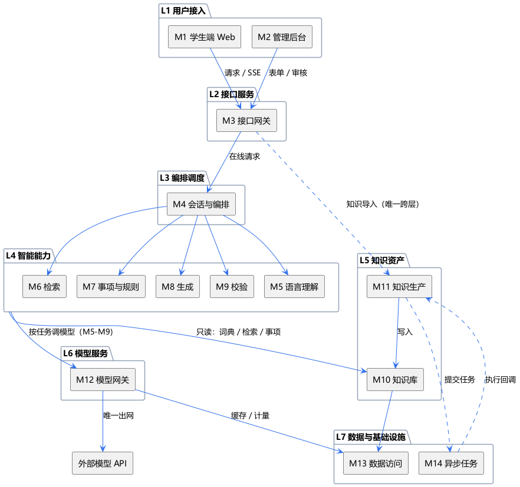

## 1 模块总览

| 编号  | 模块      | 层   | 一句话职责                         |
| --- | ------- | --- | ----------------------------- |
| M1  | 学生端 Web | L1  | 对话、双栏对照（答案 / 原文 / 清单）、清单勾选与导出 |
| M2  | 管理后台    | L1  | 知识录入与审核、事项维护、模型槽位、运营看板、评测与反馈  |
|     |         |     |                               |
| M3  | 接口网关    | L2  | 路由、鉴权、限流、审计、SSE 出口            |
|     |         |     |                               |
| M4  | 会话与编排   | L3  | 会话状态、意图路由、能力调度、结果装配           |
|     |         |     |                               |
| M5  | 语言理解    | L4  | 意图分类、查询改写、别名映射、子问题拆分          |
| M6  | 检索      | L4  | 嵌入、向量 + 全文召回、融合、重排、过滤         |
| M7  | 事项与规则   | L4  | 事项匹配、槽位抽取、规则求值、清单与流程路径        |
| M8  | 生成      | L4  | 证据组装、提示构造、流式生成、引用锚标注          |
| M9  | 校验      | L4  | 引用核对、实体与数值一致性、可答性判定           |
|     |         |     |                               |
| M10 | 知识库     | L5  | 四库与索引的只读查询、版本与时效              |
| M11 | 知识生产    | L5  | 解析、切分、元数据、冲突检测、审核发布、回滚        |
|     |         |     |                               |
| M12 | 模型网关    | L6  | 供应商适配、任务路由、重试熔断、降级、缓存、计量      |
|     |         |     |                               |
| M13 | 数据访问    | L7  | 仓储、缓存、对象存储的统一接口               |
| M14 | 异步任务    | L7  | 排队与执行：解析建索引、批量评测              |
|     |         |     |                               |
| M15 | 评测与反馈   | 离线  | 反馈归因、黄金集、批量回归、指标看板            |

---

## 2 模块调用关系

