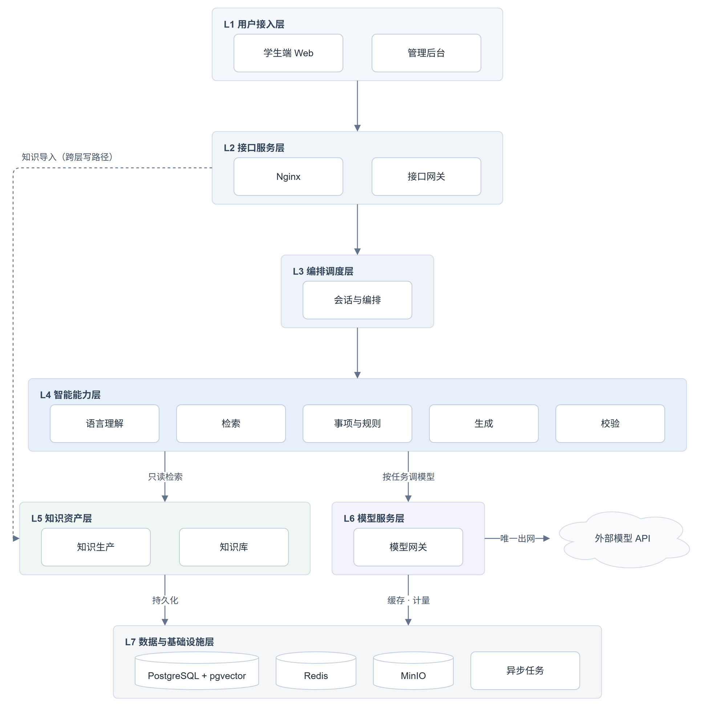
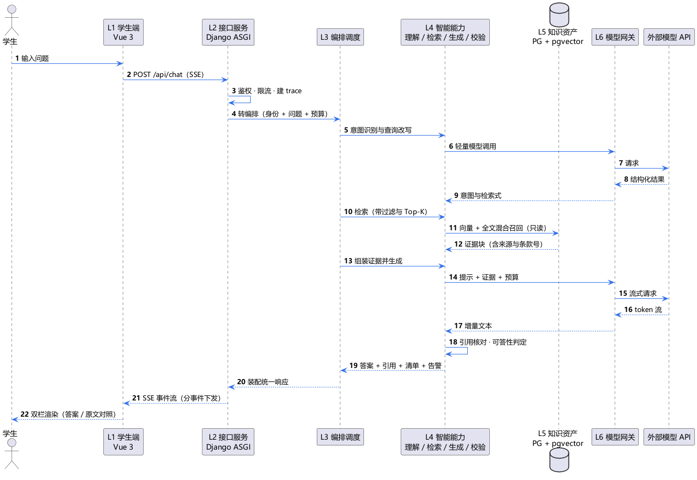
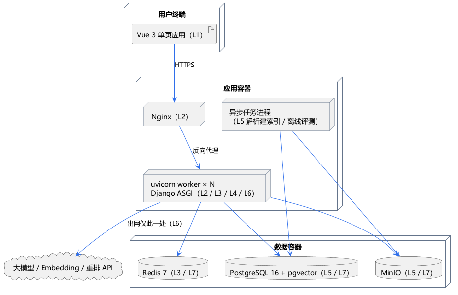

## 1 层次总览

| 层   | 名称       | 主要技术载体                            | 职责                      |
| --- | -------- | --------------------------------- | ----------------------- |
| L1  | 用户接入层    | Vue 3 单页应用、Django Admin           | 把系统的能力变成可操作的界面          |
| L2  | 接口服务层    | Nginx、Django ASGI、django-ninja    | 把外部请求变成可控的内部调用          |
| L3  | 编排调度层    | Django 应用内的编排服务                   | 决定一次请求依次做什么、并行做什么、失败怎么办 |
| L4  | 智能能力层    | Embedding、检索融合重排、提示工程、大模型 API     | 把问题变成有依据的答案             |
| L5  | 知识资产层    | PostgreSQL + pgvector、MinIO、解析流水线 | 提供唯一可信的知识事实源            |
| L6  | 模型服务层    | httpx、供应商适配器、重试与降级链               | 屏蔽模型差异，保证模型故障不影响系统可用    |
| L7  | 数据与基础设施层 | PostgreSQL、Redis、MinIO、异步任务、容器    | 提供持久化、缓存、对象存储与异步执行      |

---

## 2 链路层次

| 段   | 穿越                | 动作                                            |
| --- | ----------------- | --------------------------------------------- |
| 接入  | L1 → L2           | POST `/api/chat/`，鉴权、限流、建立 trace_id           |
| 编排  | L2 → L3           | 把请求变成一次 turn，判定 direct / single / fanout，给出预算 |
| 理解  | L3 → L4 → L6 → 外部 | 意图识别与查询改写，走轻量槽位                               |
| 检索  | L3 → L4 → L5      | 向量与全文混合召回、融合重排，返回带来源的证据块                      |
| 生成  | L3 → L4 → L6 → 外部 | 提示加证据流式生成，增量文本逐段回传                            |
| 校验  | L4 内部             | 引用核对与可答性判定，不通过转四类拒答之一                         |
| 回程  | L3 → L2 → L1      | 装配统一响应，按事件下发 SSE，前端双栏渲染                       |

---

## 3 部署层次

| 层   | 物理落点                   | 说明                               |
| --- | ---------------------- | -------------------------------- |
| L1  | 用户浏览器                  | 静态资源由 Nginx 托管，前端不含任何密钥          |
| L2  | Nginx + uvicorn worker | 无状态，可水平加 worker；SSE 要求关闭该路径的响应缓冲 |
| L3  | 与 L4 同进程               | 会话状态放 Redis 而非进程内存，保证多 worker 一致 |
| L4  | 同进程（在线）                | 检索与生成是 CPU/IO 混合型，随 worker 扩展    |
| L5  | PG + MinIO + 异步任务进程    | 解析与建索引不占在线 worker，避免长任务拖垮响应      |
| L6  | 同进程客户端 + 出网            | 全系统唯一持有 API Key 的位置，密钥来自环境变量     |
| L7  | 独立容器                   | Redis 兼作限流计数与语义缓存，与业务库分离便于淘汰     |

