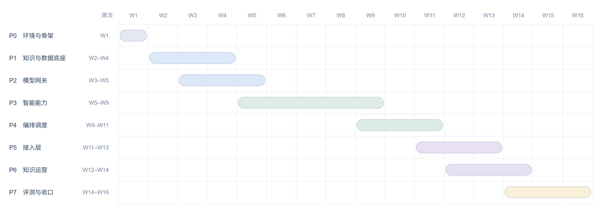

## 1 阶段总览

| 阶段  | 概要      | 周次      | 覆盖模块            |
| --- | ------- | ------- | --------------- |
| P0  | 环境与骨架   | W1      | —               |
| P1  | 知识与数据底座 | W2–W4   | M13 M10 M11 M14 |
| P2  | 模型网关    | W3–W5   | M12             |
| P3  | 智能能力    | W5–W9   | M5 M6 M7 M8 M9  |
| P4  | 编排调度    | W9–W11  | M4              |
| P5  | 接入层     | W11–W13 | M3 M1           |
| P6  | 知识运营    | W12–W14 | M2 M11          |
| P7  | 评测与收口   | W14–W16 | M15             |

---

## 2 各阶段任务

| 阶段  | 关键任务                                                        | 产出                                      |
| --- | ----------------------------------------------------------- | --------------------------------------- |
| P0  | 容器编排与环境变量分层；Django 工程与 django-ninja 挂载；Vue 脚手架与代理；依赖锁定      | `docker-compose.yml`、后端骨架、前端骨架          |
| P1  | 建表（文档/块/事项/流程/词典/索引）；仓储层与对象分桶；解析→切分→元数据→入库流水线；异步任务进程        | M13、M10、M11（入库侧）、M14；`ingest` 命令；50 份语料 |
| P2  | 三类任务的供应商适配（chat / embedding / rerank）；超时、重试、熔断、降级；语义缓存；调用计量 | M12 客户端；故障注入脚本；费用与延迟台账                  |
| P3  | 意图分类与改写；向量 + 全文混合召回、融合、重排；事项匹配与槽位；提示构造与引用锚；引用核对与可答性判定       | M5–M9 代码；提示模板集；`qa_eval` 回归基线           |
| P4  | 会话状态（Redis）；意图路由；能力 fan-out 与结果装配；SSE 事件协议；失败兜底             | M4 编排器；SSE 事件定义                         |
| P5  | 路由、鉴权、限流、审计、SSE 出口；对话页与双栏对照；清单勾选与导出                         | M3、M1 页面；接口文档                           |
| P6  | 上传与解析任务管理；审核队列；版本发布与回滚；事项与词典维护；模型配置                         | M2 页面；发布与回滚流程                           |
| P7  | 反馈归因；黄金集沉淀；批量回归；指标看板；降级演练                                   | 评测报告（可复现）；指标看板；论文可引用的基线数字               |
